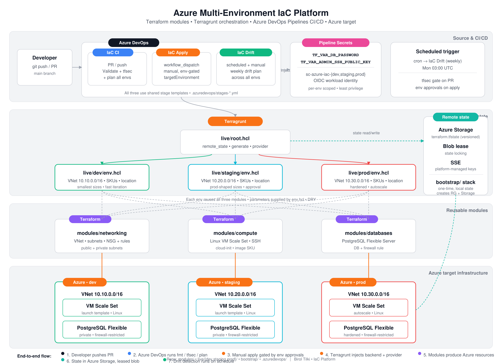

# Multi-Environment IaC on Azure

Provision **dev**, **staging**, and **prod** Azure infrastructure with **Terraform**, **Terragrunt**, and **Azure DevOps** (validate, tfsec, plan, gated apply, drift detection).

This is a **production-pilot** baseline: a working multi-environment layout with remote state and gated CI. Harden it before using it as a real prod subscription — see [SECURITY.md](SECURITY.md) and [docs/architecture/roadmap.md](docs/architecture/roadmap.md).

**Related platform:** [aws-multi-env-iac](https://github.com/btilki/aws-multi-env-iac) (same layout on AWS).



---

## Documentation

| Document | Description |
|----------|-------------|
| [docs/README.md](docs/README.md) | Documentation index |
| [docs/architecture/](docs/architecture/) | Overview, design, state, governance, promotion, roadmap |
| [docs/onboarding/](docs/onboarding/) | Deploy guide and full runbook |
| [docs/runbooks/](docs/runbooks/) | Troubleshooting and operations |
| [docs/diagrams/](docs/diagrams/) | Architecture PNG |
| [docs/incident-response/](docs/incident-response/) | Severity, escalation, rollback |
| [SECURITY.md](SECURITY.md) | Security model and controls |
| [CHANGELOG.md](CHANGELOG.md) | Repository change history |

---

## Quick start

```bash
# Prerequisites: terraform, terragrunt, az — see docs/onboarding/README.md
cp bootstrap/terraform.tfvars.example bootstrap/terraform.tfvars
# Edit tfvars; align live/root.hcl; configure Azure DevOps — see docs/onboarding/deployment.md

make bootstrap-init bootstrap-plan    # then bootstrap-apply when ready
export TF_VAR_db_password='...'
export TF_VAR_admin_ssh_public_key='...'
make tg-init-dev tg-plan-dev          # then tg-apply-dev when ready
```

**Full runbook:** [docs/onboarding/runbook.md](docs/onboarding/runbook.md)

---

## Platform capabilities

- **IaC:** VNet, public/private subnets, NSG, Linux VMSS, PostgreSQL Flexible Server (`modules/`, `live/`)
- **Orchestration:** Terragrunt multi-env layout, remote state in Azure Storage (`bootstrap/`, `live/root.hcl`)
- **CI:** Azure DevOps validate, fmt, tfsec, plan all environments on PR/main
- **Delivery:** Manual apply per environment with Azure DevOps environment gates
- **Operations:** Manual drift detection (`azure-pipelines-drift.yml`; optional weekly schedule is commented out)

---

## Repository layout

```text
├── README.md, LICENSE, Makefile, SECURITY.md, CODEOWNERS, CHANGELOG.md
├── azure-pipelines*.yml, .azuredevops/
├── bootstrap/                 # Remote state foundation (terraform + provider pins)
├── live/
│   ├── root.hcl               # Remote backend + generated versions.tf / provider.tf
│   ├── dev|staging|prod/      # Terragrunt stacks per environment
│   └── ...
├── modules/                   # networking, compute, databases
└── docs/
    ├── architecture/
    ├── onboarding/
    ├── runbooks/
    ├── diagrams/
    └── incident-response/
```

There are **no** `.tf` files at the repository root. Terraform version and provider constraints are defined in `bootstrap/main.tf` and generated under each Terragrunt working directory from `live/root.hcl`.

---

## Scope

- Three Azure environments with separate address spaces and sizing (`live/*/env.hcl`)
- Secrets via Azure DevOps variables or local exports — never committed
- **Production-pilot baseline:** no NAT or route tables; public subnets are unused by compute and databases; PostgreSQL allows public access; SSH CIDR defaults to `0.0.0.0/0`. Azure DevOps service connections must exist before pipelines succeed. See [SECURITY.md](SECURITY.md) and the [roadmap](docs/architecture/roadmap.md).

---

## Local development

```bash
make help              # all targets
make validate          # fmt checks + bootstrap + Terragrunt validate (all envs, no backend)
make tg-fmt-check      # terragrunt hcl fmt --check  (Terragrunt 1.x)
pre-commit install     # optional — see .pre-commit-config.yaml
```

---

## License

See [LICENSE](LICENSE) (Apache License 2.0).
