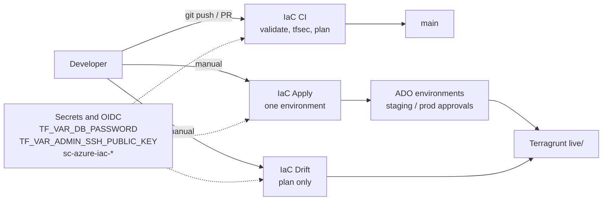

# Environment promotion model

This describes how changes move from a branch to live infrastructure using the **three Azure DevOps pipelines** in the repo root.

Source: [../diagrams/README.md](../diagrams/README.md#1-change-flow).

## Branch and PR flow

- **Feature branches**: open a PR to `main`. The **IaC CI** pipeline (`azure-pipelines.yml`) should run: validate, `tfsec`, and **plan for all environments** (`dev`, `staging`, `prod`).
- **Merge to `main`**: code on `main` is the source of truth. CI should stay green before you promote applies.

Promotion of **actual resources** is a separate, controlled step (manual apply pipeline), not an automatic consequence of merging.

## Promotion path

1. Merge to `main` with **IaC CI** passing (especially plans for the envs you will touch).
2. Run **IaC Apply** (`azure-pipelines-apply.yml`) with `targetEnvironment = dev`.
3. Run smoke or functional checks in `dev`.
4. Run **IaC Apply** with `targetEnvironment = staging` (with environment approvals if configured).
5. Run **IaC Apply** with `targetEnvironment = prod` (stricter approvals and change window as your org requires).

## Controls

- **Azure DevOps environments**: `dev`, `staging`, `prod` — use approvals/checks on `staging` and `prod`.
- **Service connections**: one per env (`sc-azure-iac-*`) so blast radius and RBAC stay scoped.
- **Concurrency**: apply pipeline runs one deployment job per selected environment; avoid overlapping applies to the same env (coordinate in your process or add pipeline concurrency options if needed).

## Drift and ongoing hygiene

- **IaC Drift** (`azure-pipelines-drift.yml`) runs a **plan with `-detailed-exitcode`** per environment when queued manually. The weekly schedule is commented out until service connections and environment secrets exist.
- Investigate non-zero drift results before they accumulate.

## Rollback approach

- **Preferred**: revert or fix the change in Git on `main`, then run **IaC Apply** forward for the affected environment.
- **Break-glass only**: restore a previous **state blob version** in Azure Storage if you have a documented runbook and ownership for state recovery. See [../runbooks/state-operations.md](../runbooks/state-operations.md).

## Related docs

- [../../README.md](../../README.md)
- [governance-baseline.md](governance-baseline.md)
- [state-strategy.md](state-strategy.md)
- [../incident-response/README.md](../incident-response/README.md)
