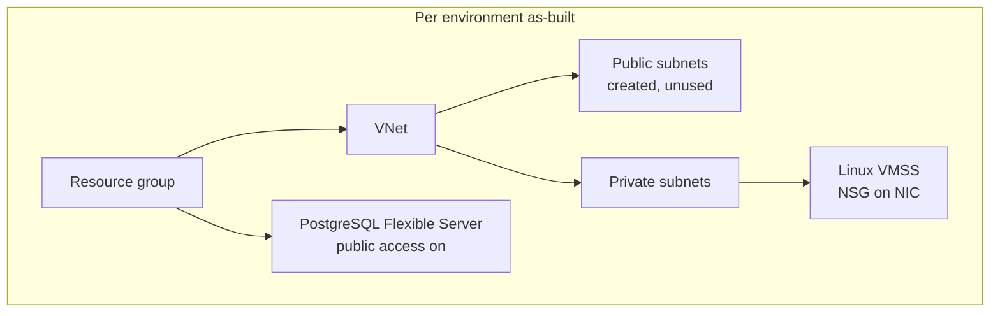
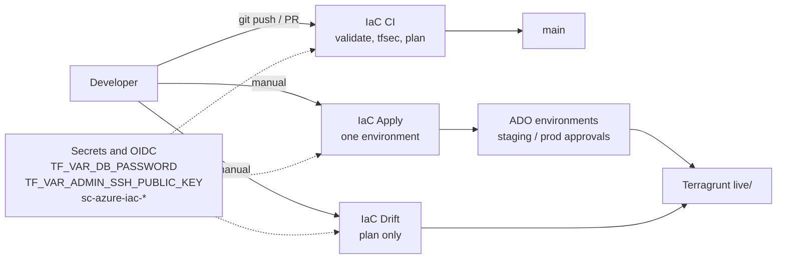

# Architecture overview

Multi-environment **Azure** infrastructure: Terraform modules, **Terragrunt** orchestration, **Azure DevOps** CI/CD, remote state in **Azure Blob Storage**.

This is a **production-pilot** baseline: stand up the layout, then harden before real prod (see [roadmap.md](roadmap.md) and [SECURITY.md](../../SECURITY.md)).

**Related platform:** [aws-multi-env-iac](https://github.com/btilki/aws-multi-env-iac) (same layout on AWS).

**Full design:** [design.md](design.md) · **Plan:** [project-plan.md](project-plan.md) · **Figures:** [../diagrams/README.md](../diagrams/README.md)

---

## Goals

- Infrastructure as code with reusable modules (`networking`, `compute`, `databases`)
- Three isolated environments: `dev`, `staging`, `prod` (separate VNets, SKUs, scale)
- Automated validate → TFLint → security scan → plan on PR and `main`
- Gated manual apply per environment; manual drift detection (optional weekly schedule in the pipeline YAML)
- Secrets only via Azure DevOps variables or local shell exports

---

## Azure topology (per environment)

| Layer | Resources |
|-------|-----------|
| State (shared) | Resource group, storage account, private blob container (`bootstrap/`) |
| Network | VNet, public/private subnets (no route tables, NAT, or NSG in the current baseline) |
| Compute | Linux VM Scale Set (SSH key auth) with NSG on the NIC (SSH ingress, HTTPS egress) |
| Data | PostgreSQL Flexible Server + database + firewall rules (public access enabled) |

Terragrunt units under `live/<env>/`: `networking` → `compute` / `databases`. Compute uses a private subnet; databases are not VNet-integrated. Public subnets are created but unused by the other stacks.

---

## CI/CD

| Pipeline | Trigger | Stages |
|----------|---------|--------|
| **IaC CI** (`azure-pipelines.yml`) | PR + push to `main` | Validate (fmt, TFLint, Terragrunt), Security (tfsec), Plan all envs |
| **IaC Apply** (`azure-pipelines-apply.yml`) | Manual | Validate, Security, Apply one env |
| **IaC Drift** (`azure-pipelines-drift.yml`) | Manual; weekly schedule commented out | Validate, Security, Drift plan all envs |

| Concern | Owner |
|---------|--------|
| Bootstrap + live stacks | Azure DevOps → Terragrunt → Terraform |
| Approvals | Azure DevOps environments (`staging`, `prod`) |

Service connections (exact names): `sc-azure-iac-dev`, `sc-azure-iac-staging`, `sc-azure-iac-prod`.

---

## Related

- [state-strategy.md](state-strategy.md)
- [governance-baseline.md](governance-baseline.md)
- [environment-promotion.md](environment-promotion.md)
- [../onboarding/runbook.md](../onboarding/runbook.md)
