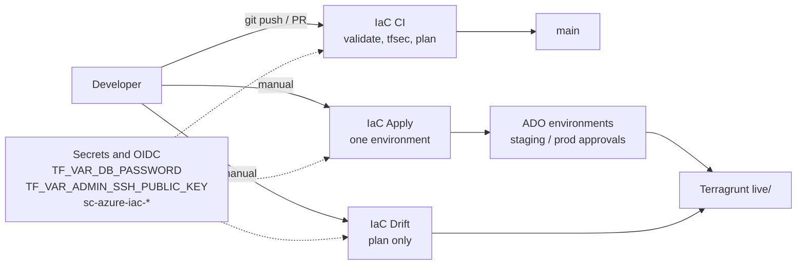
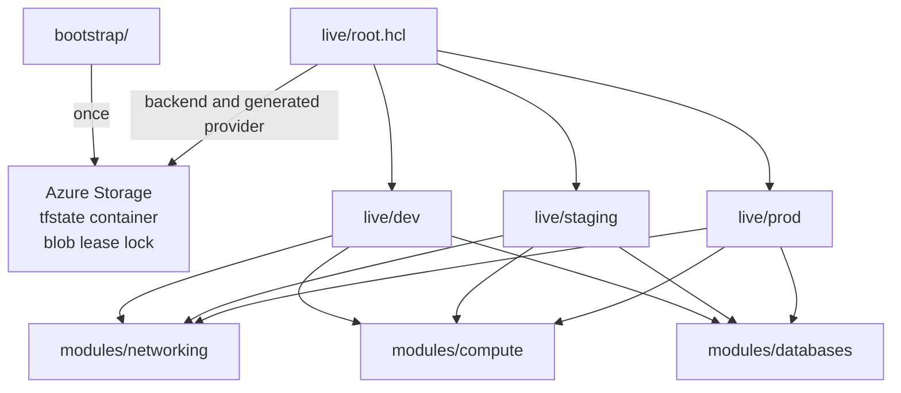
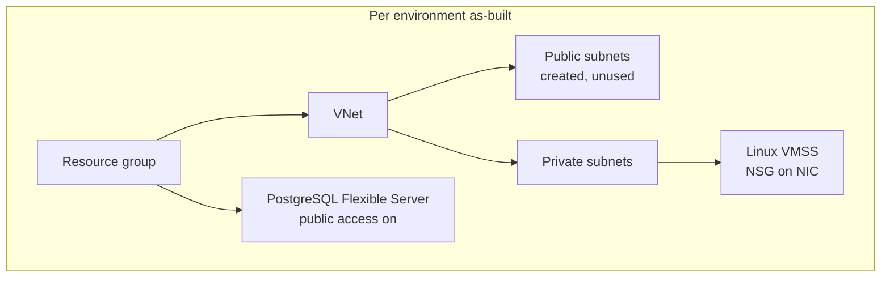

# Diagrams

Architecture figures as **Mermaid** (diagrams as code). GitHub renders the blocks below. Source files are the matching `.mmd` files in this folder.

This is a **production-pilot** baseline. The figures match as-built modules, not a hardened production landing zone.

| Figure | Source | Used in |
|--------|--------|---------|
| 1. Change flow | [01-change-flow.mmd](01-change-flow.mmd) | README, overview CI/CD, environment promotion, architecture article |
| 2. Terragrunt and state | [02-terragrunt-state.mmd](02-terragrunt-state.mmd) | design, state strategy, architecture article |
| 3. Azure topology | [03-azure-topology.mmd](03-azure-topology.mmd) | overview topology, design modules, architecture article |

---

## 1. Change flow

Developer change, Azure DevOps pipelines, secrets, and gated apply. Drift is **manual**; the weekly schedule in `azure-pipelines-drift.yml` is commented out.

---

## 2. Terragrunt and state

Bootstrap creates remote state once. `live/root.hcl` injects the Azure backend and generated provider. Each environment calls the same three modules. State blob keys are `{env}/{stack}/terraform.tfstate`.

---

## 3. Azure topology

One environment. Compute uses a private subnet and an NSG on the NIC. Databases are not VNet-integrated. Public subnets exist and are unused. CIDRs and SKUs differ per `live/*/env.hcl` (dev `10.10.0.0/16`, staging `10.20.0.0/16`, prod `10.30.0.0/16`).

